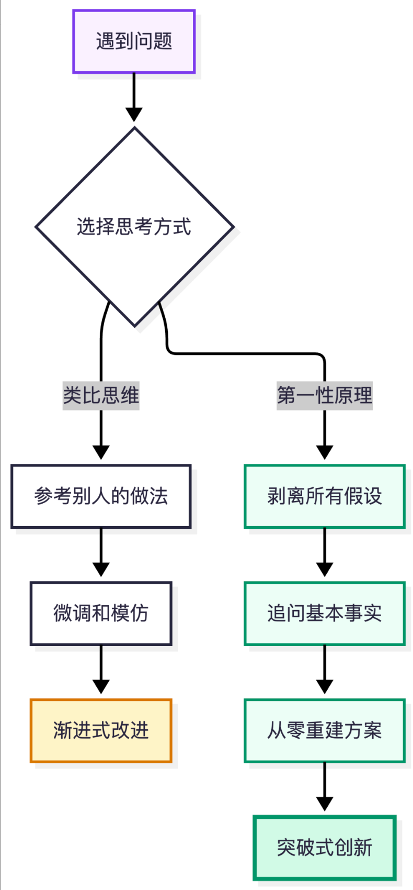

## 第一性原理和类比思维

第一性原理来自亚里士多德《形而上学》

> 在每一个系统性探索中，都存在一个第一性原理。它是一个最基本的命题或假设，不能被省略，不能被违反，也不能被推翻。

遇到问题时，大多数人的思考方式是**类比思维**：别人怎么做，我就怎么做。类似思维的好处是参考别人已经验证过的路径，效率高、风险低；坏处是它只能产生渐进式的改进，不容易产生真正的突破。

第一性原理思维则完全不同。它是一种回到事物本质的思考方式，它要求你：

1. **识别并剥离所有假设**——别人说的、行业惯例、「大家都这么做」，这些通通先放到一边
2. **追问到不可再分的基本事实**——物理定律、数学规律、人类的基本需求
3. **从这些基本事实出发，重新构建解决方案**——不受任何既有框架的束缚

埃隆·马斯克是「第一性原理」的推崇者和践行者，SpaceX可回收火箭、Telsa电动车，都是用第一性原理思考的产物。

在LLM时代，第一性原理更加重要了，因为**大模型擅长的是模式匹配和类比推理，是类比思维的终极形态，而第一性原理思维是AI最难替代的人类能力**。

当AI可以在几秒内给你十种方案时，真正有价值的能力变成了：**判断哪种方案是对的，以及提出第十一种完全不同的方案**。这两件事都需要你理解底层原理，而不仅仅是比较表面上的相似性。

| AI擅长                                                       | 人类独特优势                                                 |
| ------------------------------------------------------------ | ------------------------------------------------------------ |
| 模式匹配 → 大量数据中找规律  类比推理 → 基于已有模式生成新内容 | 跨域洞察 → 将不相关领域的底层原理连接  第一性原理思维 → 从基本事实出发原创推理  价值判断 → 判断什么是真正重要的 |

把AI当搜索引擎用，这是类比思维的用法；更好的方式是用第一性原理来和AI协作：**先自己想清楚基本事实和核心需求**，然后把这些告诉AI，让AI在你定义的框架内去执行。**你负责定义问题的边界和底层逻辑，AI负责在这个空间里穷尽可能性**。

运用第一性原理思考：

- 职业选择

  1. 我能创造什么价值？（不是「我有什么学历」，而是「我能解决什么问题」）
  2. 谁需要这个价值？（不是「什么行业热门」，而是「什么需求真实存在且未被很好满足」）
  3. 我能持续创造这个价值吗？（不是「现在能赚多少」，而是「五年后这个能力还稀缺吗」）

- 创业和创新

  杰夫·贝索斯有一句经典的话：「我经常被问到未来十年会有什么变化，但很少有人问我未来十年什么不会变。第二个问题其实更重要，因为你可以围绕不变的东西建立商业战略。」这就是第一性原理在商业中的精髓：**找到不变的基本事实，围绕它构建一切**。

## 学会区分事实、假设、约束、价值判断

运用第一性原理，首先要学会区分四种东西——事实、假设、约束、价值判断，这是第一性原理非常重要的一项基础能力。很多时候，我们之所以无法正确思考，是因为把这四种东西混在了一起：

| 类型     | 含义                     | 处理方式                                         |
| -------- | ------------------------ | ------------------------------------------------ |
| 事实     | 已经观察或验证的客观情况 | 需要理解和利用                                   |
| 假设     | 尚未验证的判断           | 需要验证，不能直接当作结论                       |
| 约束     | 当前必须满足的条件       | 需要判断是真正不可突破的限制，还是人为形成的限制 |
| 价值判断 | 我们认为哪些结果更重要   | 需要明确优先级，不能假装它是客观事实             |

很多人把自己的假设伪装成客观约束。例如：

- 「这个功能必须用微服务实现。」
- 「创业必须先融资。」
- 「AI Agent 必须使用多智能体架构。」
- 「学习大模型必须先掌握全部数学知识。」

这些话里面可能有合理成分，但它们都不是天然成立的基本事实。

你需要追问：

1. 为什么必须这样？
2. 如果不这样，会发生什么？
3. 有什么证据证明这样做更好？
4. 有没有其他方案能够满足相同需求？

我建议你以后遇到重要问题时，先把这四类信息分开写下来。

这是避免被既有认知和未经验证的假设牵着走的有效方法。

## 第一性原理的完整思考流程

定义问题 → 拆解事实 → 寻找根因 → 重新构建 → 推导预测 → 最小实验 → 反馈迭代

1. **定义问题**：

   我究竟要解决什么问题？最终想实现什么目标？

2. **拆解事实**：

   把问题拆解成最基本的组成部分，区分事实、假设、约束和主观偏好。

3. **寻找根因**：

   找出真正决定结果的关键因素，以及因素之间的因果关系。

4. **重新构建**：

   暂时抛开行业惯例和既有方案，从基本事实出发推导解决方案。

   如果今天从零开始，我会怎么设计？

5. **推导预测**：

   对自己的方案提出可以验证的预测。

   如果我的判断正确，实际应该出现什么结果？

6. **最小实验**：

   设计成本最低、反馈最快的实验，验证自己的判断。

   不要只停留在思考，尽快进入现实。

7. **反馈迭代**：

   根据实验结果修正假设、调整方案，重新开始下一轮思考。

   让现实结果决定你的认知，而不是维护自己的观点。

这是一套从认知到行动、再从行动回到认知的闭环。

对上述流程的三点重要认知

1. **从「追问为什么」升级为「建立因果模型」**，这是第一性原理从普通思考升级到深度思考的关键。

不要看到问题就寻找解决方案，而要先理解问题产生的机制。第一性原理帮助你拆解事物，系统思维帮助你理解事物之间的关系。

假设你正在设计一个 AI Agent 系统，发现任务成功率不高。普通思维可能是：换一个更强的模型、增加一个 Agent、增加一些 Prompt、接入更多工具、增加 RAG。这些都是已有经验提供的解决方案。

第一性原理应该先问：Agent 任务成功率究竟由什么决定？我们可以建立一个初步的因果模型。

1. **寻找真正的杠杆点，而不是平均用力**

当你把问题拆解之后，通常会发现影响最终结果的因素有很多。但并不是每个因素都值得投入同样多的精力。**真正优秀的思考者，会寻找那些能够以较小投入，产生较大结果的关键因素**。

你不应该把这些事情平均分配资源，而应该思考：

1. 哪个因素对最终结果影响最大？
2. 哪个因素目前是整个系统的瓶颈？
3. 改善哪个因素能够带来最大的边际收益？
4. 哪个因素的改善成本最低？

杠杆效应的核心思想是：找到能够放大投入效果的关键位置。

瓶颈理论：系统的整体产出往往受到最薄弱环节的限制。因此，优化系统时，不应该盲目优化所有模块，而应该优先找到并改善当前瓶颈。

例如：

- 学习：与其每天花大量时间记忆零散知识，不如先建立知识体系，找到关键概念之间的联系。
- 工作：与其每天重复处理问题，不如建立自动化机制，从根本上消除重复劳动。
- 创业：与其不断增加功能，不如找到用户真正愿意付费解决的核心需求。
- 技术架构：与其不断增加机器，不如先找出系统真正的性能瓶颈。

1. **主动寻找反例，而不是证明自己正确**

人有一种天然倾向：**当我们形成一个观点之后，会下意识寻找支持自己观点的信息，而忽略反对的信息。这叫确认偏误**（Confirmation Bias）。

第一性原理要求你不仅能够建立自己的观点，还要主动寻找能够推翻自己观点的证据。

例如，你认为：

「AI Agent 应该采用多智能体架构，因为多个 Agent 分工合作能够提高任务成功率。」

不要急着证明它正确，应该反过来问：

1. 有没有单 Agent 表现更好的案例？
2. 多 Agent 增加了多少通信和协调成本？
3. 多 Agent 是否引入了新的错误传播路径？
4. 如果任务可以通过一个模型加工具调用完成，为什么需要多个 Agent？
5. 在什么情况下，多 Agent 才真正具有优势？

这时你会发现：多智能体不是天然优于单智能体，它只是在某些任务结构下具有优势。

真正重要的不是你支持哪种架构，而是你能否找到它成立的条件和边界。

我建议你养成三个习惯：

- 寻找反例：有没有情况能够推翻我的结论？
- 主动证伪：什么样的实验结果会让我承认自己错了？
- 反向论证：如果我站在反对者的角度，我会如何攻击自己的观点？

## 第一性原理必须落实为行动

真正的认知提升，不是知道更多道理，而是改变自己的判断和行动。

需要主动建立一个机制：

**每一次深度思考，都必须尽可能转化为一个现实中的行动**。

第一性原理实践记录：

1. 我真正要解决的问题
2. 已知事实
3. 未验证的假设
4. 核心约束与根本原因
5. 从零出发，我会怎么做
6. 如何验证我的判断
7. 下一步行动
8. 结果与认知修正

练习第一性原理的五个习惯：

- **习惯一：每天问一个「为什么」**

  每天选择一件你习以为常的事情，追问它的底层原因。

  不需要每个问题都找到颠覆性的答案。养成追问的习惯本身，就是在锻炼你的第一性原理肌肉。

- **习惯二：记一本「假设日记」**

  准备一个笔记本或手机备忘录，每当你做决定时，把你的假设写下来。

  比如今天你决定不投一支股票，写下你的理由。然后标注：哪些是你查证过的事实，哪些是你从别人那里听来的假设，哪些是你自己的情绪判断。

  一个月后回顾这些记录，你会惊讶地发现，你的很多决策其实是被未经检验的假设所驱动的。意识到这一点，就是改变的开始。

- **习惯三：做一个「好问题收集者」**

  好的第一性原理思考，始于好的问题。养成收集好问题的习惯：

  「这件事的根本目的是什么？」「如果从零开始，我会怎么做？」「哪些是物理限制，哪些是人为限制？」「如果这个行业不存在，人们的需求会通过什么方式满足？」「五年后回头看，今天的哪些常识会被证明是错的？」

- **习惯四：跨领域阅读**

  第一性原理的很多突破来自于**跨领域的连接**。进化生物学的原理可以解释商业竞争，物理学的框架可以启发人际沟通，经济学的模型可以帮助个人决策。

  每个月至少读一本你专业领域之外的书。不需要读得很深，但要尝试问自己：这个领域的第一性原理是什么？它和我自己的领域有什么相通的底层逻辑？

  查理·芒格把这种方法叫做「**多元思维模型**」。他说一个人的头脑里至少要有100个来自不同学科的思维模型，才能比较全面地理解世界。你不需要到100个，但从2-3个开始是完全可以做到的。

- **习惯五：定期「清零」**

  每隔一段时间（比如每季度一次），对你最重要的事情做一次「清零思考」：

  如果我今天是第一天来到这个公司/岗位，我会怎么安排工作？如果今天重新开始学这个技能，我会选择什么路径？如果今天重新组建这个团队，我会怎么分工？

  清零思考能帮你发现那些因为惯性而一直存在、但其实早已不合理的做法。贝索斯把这叫做「**Day1心态**」——永远像第一天一样思考，不要让组织和个人都陷入僵化。

## 第一性原理的边界

第一性原理思维不是万能钥匙。

1. **它有时间成本**。每件事都从零开始想，你什么也做不完。大部分日常决策用类比思维（习惯、经验、直觉）就很好。第一性原理应该**留给真正重要的决策**。
2. **它需要足够的知识基础**。如果你对一个领域完全不了解，你很难识别哪些是假设、哪些是基本事实。一个不懂物理的人不可能从第一性原理出发设计火箭。所以，第一性原理思维的前提是持续学习和积累。
3. **它不能替代实验**。从基本事实出发构建的方案，只是一个假说。它是否真的有效，还需要在现实中验证。马斯克的SpaceX不是一次就成功的——前三次发射全部失败，公司几乎破产。第一性原理给你方向，但不给你保证。
4. **它容易让人傲慢**。「我是从第一性原理出发的，所以我一定对」这种想法非常危险。你以为的「基本事实」很可能只是你认知范围内的基本事实。保持谦逊，愿意被证伪，才是真正的科学精神。

与其他思维方式的互补：

真正成熟的思考者，不会只用一种思维工具。第一性原理需要和其他思维方式配合使用：

- **系统思维**帮你看到事物之间的连接和反馈循环。你用第一性原理找到了根因，但如果不理解系统中各部分如何相互影响，你的解决方案可能在一个地方解决了问题，却在另一个地方制造了新问题。
- **概率思维**帮你处理不确定性。基本事实告诉你「什么是可能的」，概率思维帮你判断「可能性有多大」。这在投资、医疗、人生规划等充满不确定性的领域尤其重要。
- **逆向思维**帮你避免灾难。查理·芒格说「告诉我我会死在哪里，我就永远不去那里」。有时候不需要知道最好的方案是什么，只需要知道什么一定会失败，然后避开它。

最好的思维状态不是「我只用第一性原理」，而是工具箱里有很多工具，根据情况灵活选用。

最小行动指南：

从今天起，每当你遇到一个重要问题时，在行动之前多花两分钟，问自己三个问题：

1. 我关于这件事的假设是什么？
2. 剥掉这些假设后，最底层的事实是什么？
3. 基于这些事实，最好的方案是什么？

相关资源推荐：

- 书籍
  - 《穷查理宝典》（查理·芒格）——多元思维模型的集大成之作
  - 《思考，快与慢》（丹尼尔·卡尼曼）——理解人类认知偏误的必读书
  - 《费曼的彩虹》（莱昂纳德·蒙洛迪诺）——感受费曼如何从底层思考物理
  - 《反脆弱》（纳西姆·塔勒布）——在不确定性中如何变得更强
  - 《原则》（瑞·达利欧）——一套基于底层逻辑的生活和工作原则
- 在线资源
  - FarnamStreetBlog(fs.blog)——关于思维模型和决策的优质博客
  - JamesClear的文章([jamesclear.com](http://jamesclear.com))——对第一性原理有精彩的入门讲解
  - WaitButWhy([waitbutwhy.com](http://waitbutwhy.com))——TimUrban用第一性原理分析各种话题的长文
- 实践工具
  - 费曼技巧：学习任何新知识时，尝试用简单语言向他人解释
  - 五个为什么：遇到问题时连续追问五次「为什么」
  - 前提审查清单：做重要决策前，列出所有假设并逐一检验
